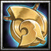

#  AnoMech

*Another FFXIV mechanics simulator*

---
 
Simulate FFXIV raid mechanics client-side for solo practice. Go to any Inn, open the plugin with `/anomech` and start practicing!

Thanks to improvemnts by [WorstAquaPlayer](https://github.com/WorstAquaPlayer) plugin is quite stable now! No more 
crashes after training session.

**WARNING!!!**

**You are cut off from server traffic while in the sim zone.** To keep the
fake zone stable, the plugin firewalls incoming packets from the server.  
While simulating:
  * Players joining or leaving your party will not appear in the party list
  until you leave the sim zone.
  * Ready checks will not pop.
 

## Installation

See: https://github.com/anomek/MyDalamudPlugins

## Beta: Advanced Simulation Resolution

The simulator now includes a beta feature that properly resolves most skills, triggers, and gauges during simulation.
As this feature is still in beta, some edge cases and less common interactions may not yet resolve correctly.

## Currently implemented 
All using default NA pf strats unless noted otherwise:
- Dancing Mad (Ultimate)
    - P1 Tele-trouncing _by [Evernow](https://github.com/Evernow)_
    - P2 Forsaken
      - NA
        - [Kroxy-Rinon 341 (Center/N Stacks) melee adjust](https://raidplan.io/plan/UATE__aDcw1-bgVv)
        - [South Adjust 341](https://raidplan.io/plan/uq7zdjvuu7uuw8fj)
        - diamond markers or week one positions
      - EU _by [Wydox](https://github.com/Wydox)_
        - [\[LPDU\] Buddies](https://raidplan.io/plan/142oXOZpPc_jh3dd)
        - [\[Old\] p3Z Buddy Meow](https://raidplan.io/plan/lZWqxfxvyhF9sp3Z)
        - [\[Old\] zP6 South adjust](https://raidplan.io/plan/rtc1FcuZFMuyBzP6)
      - JP _by [altair9x](https://github.com/altair9x)_
        - [Yan](https://yan-flash.com/ultimate/yosei-ranbu#ult-phase-2)
    - P3 Limit Cut _by [Evernow](https://github.com/Evernow)_
    - P3 Black Hole _old bh (single tethers, n/s stomps)_
      - D>S>A
      - S>D>A _by [Evernow](https://github.com/Evernow)_
    - P4 Kefka Says
      - kefkabin
      - kefkabin, gazes: supports N / DPS S _by [Evernow](https://github.com/Evernow)_
    - P5 Flood _by [Evernow](https://github.com/Evernow)_
    - P5 Exaflares _by [Wydox](https://github.com/Wydox)_
    - P5 Celestriad _by [RoarkGit](https://github.com/RoarkGit)_
    - P5 Forsaken Null _no ai or damage_
- Futures Rewritten (Ultimate) _by [grayparser](https://github.com/grayparser)_
    - P2 Diamond Dust 
    - P2 Light Rampant
    - P3 Ultimate Relativity
    - P3 Apocalypse 
    - P4 Darklit Dragonsong
      - NA
      - NA, you take Somber Dance
    - P4 Crystallize Time 
    - P5 Fulgent Blade
    - P5 Paradise Regained 
- The Omega Protocol (Ultimate)
    - P2 Party Synergy
      - NA pf
      - LPDU _by [Quantumlyy](https://github.com/Quantumlyy)_
    - P5 Delta
    - P5 Sigma
    - P5 Omega
    - P6 Exasquares / Wave Cannon 2
- The Weapon's Refrain (Ultimate)
    - P1 Garuda _by [Asunnya](https://github.com/Asunnya)_
    - P2 Ifrit _by [Asunnya](https://github.com/Asunnya)_
    - P3 Titan _by [Asunnya](https://github.com/Asunnya)_
    - Ultimate Predaction _by [WorstAquaPlayer](https://github.com/WorstAquaPlayer)_
    - Ultimate Annihilation _by [Asunnya](https://github.com/Asunnya)_
    - Ultimate Suppression _by [WorstAquaPlayer](https://github.com/WorstAquaPlayer)_
- The Unending Coil of Bahamut (Ultimate) _by [RoarkGit](https://github.com/RoarkGit)_
    - Exaflares

## Details

* Spawns fake party members and boss NPCs into the live game client
* Drives their positions, cast bars, tethers, and VFX so mechanics play out visually
* Your fake party members are full fledged bots that will do mechanics.  
  Some scanarios also have solo mode where you can practice without disctractions.

## How to help
1. Please provide feedback and report any issues in scenarios: bad timing, damage, config not working at it supposed
2. Bot AI currently only covers strategies from my region. Adding strategies for other regions requires little coding.
   Feel free to create pull request or contact me.
3. Adding new scenario is more involved. `tools/parser.py` generates a baseline scenario from a log, which still
   needs randomization, mechanic-failure logic and bot AI added by hand.
4. Plugin-development or reverse-engineering help, and improvement ideas, are also welcome.

## Known issues
* Visuals should closely match retail, but damage snapshot timings are best guesses
* In scenarios for Top Omega Protocol (Ultimate):
  * Tether distance threshold are very rough estimations
* Not all skills will resolve properly

#  Acknowledgments

Thanks for contributors:
* [WorstAquaPlayer](https://github.com/WorstAquaPlayer) - rewriting core & fixing crashes, extra scenarios
* [Wydox](https://github.com/Wydox) - core improvements, extra scenarios and strategies
* [Evernow](https://github.com/Evernow) - multiplayer (WIP), core improvements, extra scenarions and strategies
* [RoarkGit](https://github.com/RoarkGit) - win streaks, extra scenarios
* [grayparser](https://github.com/grayparser) - core improvements, extra scenarios
* [altair9x](https://github.com/altair9x) - extra strategies
* [Quantumlyy](https://github.com/Quantumlyy) - extra strategies
* [Linqx](https://github.com/Linqx) - success/failure checkmarks

AnoMech leans heavily on the work of other Dalamud plugins. Huge thanks to their authors!  
Without them, the following would not be possible:

AnoMech's zone changes are built on **Hyperborea**, which served as the baseline for loading a solo duty arena.                                                                                                                                                                                   
[Evernow](https://github.com/Evernow) has since improved that code and made it safer to use.                                                                                                                                                                                                      

**FFXIV-RaidsRewritten** and **bossmod** were the initial inspiration for the project, though neither is part of the                                                                                                                                                                              
codebase anymore.
